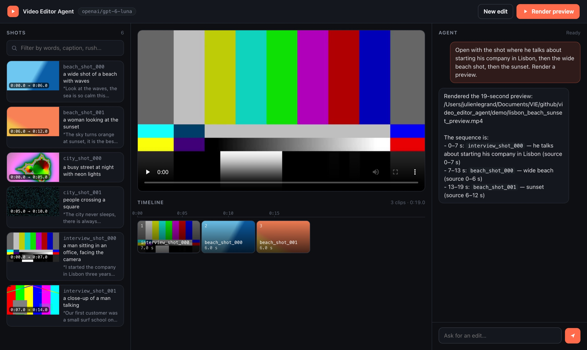
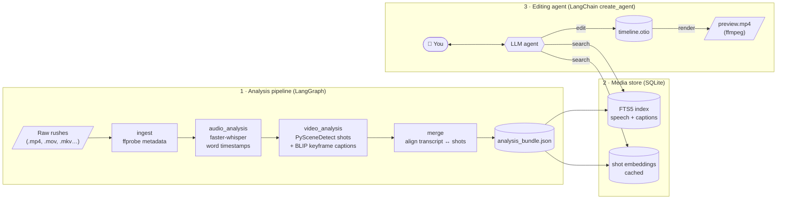

# 🎬 Video Editor Agent

[](https://github.com/OdakK/video_editor_agent/actions/workflows/ci.yml)

**Edit video by talking to an agent.** Drop your raw footage in a folder, let the pipeline watch and listen to it, then ask for a rough cut in plain language:

> *"Find the shot where she talks about the blue sky, put it at the start, then add the wide shot of the beach after it and render a preview."*

The agent searches your rushes by meaning or by keyword, places shots on an [OpenTimelineIO](https://opentimelineio.readthedocs.io/) timeline, cuts, moves and removes clips, and renders an MP4 preview with ffmpeg. Everything runs locally except the LLM call.

Built with **LangGraph**, **faster-whisper**, **PySceneDetect**, **BLIP**, **SentenceTransformers**, **SQLite FTS5** and **OpenTimelineIO**.



*The web UI on the demo footage (synthetic test patterns): one request, and the agent searched the shots, built the timeline and rendered the preview.*

---

## How it works

The project is split into two parts: an **offline analysis pipeline** (a LangGraph graph) that turns raw footage into structured, searchable data, and a **conversational agent** that edits a timeline with tools.



1. **Ingest** finds every video file in the input folder and reads its duration, frame rate and audio track with ffprobe. Files without audio skip transcription.
2. **Audio analysis** transcribes each rush with faster-whisper (voice-activity filtering, word-level timestamps).
3. **Video analysis** detects shot boundaries with PySceneDetect, extracts a keyframe per shot and captions it with BLIP (optional).
4. **Merge** aligns transcript segments with the shots they overlap, producing "timeline atoms": one shot, its timecodes, what is said and what is seen.
5. **Media store** loads the bundle into SQLite: an FTS5 index over both speech and captions for exact queries, and one embedding per shot (transcript + captions) for semantic search. Embeddings are computed once and cached in the database.
6. **Editing agent** is a tool-calling LLM that combines search and timeline tools to answer requests and build the edit. Tool errors (unknown shot, empty timeline…) are sent back to the model so it can correct itself.

## Agent tools

| Tool | What it does |
|---|---|
| `semantic_search` | Shots closest in meaning to a description, using what is said **and** what is seen. |
| `keyword_search` | Exact words in transcripts and captions, with FTS5 syntax (`AND`, `OR`, `NEAR`, `"phrase"`). Plain text with punctuation also works. |
| `list_shots` | Browse the shot catalog, optionally for one rush. |
| `shots_for_segment` | Map a transcript segment back to its shot(s). |
| `initialize_timeline` | Start a new empty OTIO timeline. |
| `insert_shot` | Place a shot at the end, or before the clip playing at a given time. |
| `split_clip` | Cut the clip playing at a given time into two. |
| `remove_clip` / `move_clip` | Remove a clip or change its position. |
| `describe_timeline` | The current edit: clip ids, order, timeline and source timecodes. |
| `render_preview` | Render to MP4 with ffmpeg: scales and pads to the largest source, falls back to silent output if a rush has no audio. |

All edits are non-destructive: the source files are never touched, and the `.otio` file can be opened in other OTIO-compatible tools or converted to EDL.

## Getting started

### Prerequisites

- Python 3.12 and [uv](https://github.com/astral-sh/uv)
- `ffmpeg` and `ffprobe` on your `PATH`
- An API key for the LLM: OpenAI GPT-6 Luna by default, or any provider supported by LangChain (`VIDEO_AGENT_MODEL=anthropic:...`, `azure_openai:...`), or OpenRouter (see `.env.example`)

### Install

```bash
git clone https://github.com/OdakK/video_editor_agent.git
cd video_editor_agent
uv sync --extra analysis      # Whisper, BLIP, PySceneDetect, sentence-transformers
cp .env.example .env          # then add your API key
```

### 1. Analyze your rushes

```bash
uv run video-agent analyze --input-dir ./rushes
```

Options: `--whisper-model small` (faster) or `large-v3` (more accurate), `--language fr`, `--threshold 27` (more sensitive shot detection), `--no-captions`.
This writes `output/analysis_bundle.json` and one JPEG keyframe per shot in `output/keyframes/`.

> Whisper and BLIP are heavy: CPU works but is slow, a GPU or Apple Silicon helps a lot.

### 2. Edit in the web UI

```bash
uv sync --extra analysis --extra ui
uv run video-agent ui              # opens http://127.0.0.1:8000
```

Shot library on the left, preview and timeline in the middle, the agent on the right. You can edit by hand
(add, move, remove clips, render) or ask the agent, and watch each tool call stream in while it works.
Manual and agent edits go through the same timeline code.

**Import rushes from the page**: click *Import* or drop video files on the shot library. Each file is
analyzed in the background (transcription, shot detection, captions), with its progress shown in the
library, then indexed and added to the existing analysis. The UI starts with an empty library if you
have not analyzed anything yet. Without the `analysis` extra, imports fall back to a basic mode: one
shot per file, with a keyframe but no transcript. Imports use Whisper `small` by default, for a
reasonable wait (`--whisper-model` to change it).

**Delete a rush** with the bin icon on any of its shots: its shots leave the library and its clips
leave the timeline. Only files the UI owns are deleted from disk (imported copies and keyframes);
original rushes analyzed with `video-agent analyze` are never touched.

**No rushes at hand?** `uv run video-agent ui --demo` generates three synthetic rushes with ffmpeg
(test patterns and tones, with a hand-written transcript and captions) and opens them. It needs no
ML model, only ffmpeg and an API key for the LLM.

### 3. Or talk to the editor in the terminal

```bash
uv run video-agent chat -v      # -v prints every tool call
```

Or with LangGraph Studio, to watch the graph and each tool call:

```bash
uv sync --extra analysis --extra studio
uv run langgraph dev --allow-blocking
```

Try requests like:

- *"List all the shots from the first rush."*
- *"Find where someone says 'ciel bleu' and add that shot to the timeline."*
- *"Cut the clip at 12.5 seconds, remove the second half and describe the timeline."*
- *"Render a preview to preview.mp4."*

## Tests

```bash
uv sync && uv run pytest -v
```

The tests run in a few seconds, without models or API keys: the analysis output is a small hand-made bundle and the sentence encoder is replaced by a deterministic bag-of-words hash. They cover the transcript ↔ shot alignment, keyword and semantic search (including the embedding cache), every timeline operation, **concurrent edits** (agents call tools in parallel), the ffmpeg command, the agent loop and the web UI's API with a scripted model, rush import and deletion (including broken files, name clashes, and a check that original rushes are never deleted), and an **end-to-end render**: two test clips are generated with ffmpeg, edited, rendered, and the output duration and resolution are checked. CI runs them on every push.

## Project structure

```
src/video_agent/
├── analysis/
│   ├── workflow.py   # LangGraph pipeline: ingest → audio → video → merge
│   ├── ingest.py     # Media discovery
│   ├── audio.py      # faster-whisper transcription
│   ├── video.py      # PySceneDetect shots, keyframes, BLIP captions
│   └── merge.py      # Transcript ↔ shot alignment
├── schemas.py        # Pydantic models (MediaAsset, SceneSegment, TimelineAtom…)
├── probe.py          # ffprobe metadata
├── store.py          # SQLite store: FTS5 and cached embeddings
├── timeline.py       # OTIO editing and ffmpeg rendering
├── tools.py          # The agent's tools
├── agent.py          # Editing agent (also exposed to `langgraph dev`)
├── ui/               # FastAPI server + static page (no build step), chat streamed as SSE
├── library.py        # Rush import from the UI: background analysis and re-indexing
├── demo.py           # Synthetic demo rushes
└── cli.py            # video-agent analyze | chat | ui
tests/                # Fast tests, no model or API key needed
```

## Design choices

- **Two stages, not one graph.** Analysis is slow and deterministic, and runs once per batch of rushes. Editing is fast, interactive and LLM-driven. Keeping them separate means you never re-transcribe footage to try a new edit.
- **Timeline atoms as the shared language.** Each shot carries its timecodes, overlapping transcript and captions, so the agent reasons about *shots* instead of raw frames or audio.
- **Keyword and semantic search, over speech and image.** FTS5 handles exact words and names; embeddings handle "the part where they talk about the weather". Both include the BLIP captions, so "the wide shot of the beach" works even when nobody speaks.
- **Heavy models are optional dependencies, loaded lazily.** The store, timeline and agent install and test without PyTorch, which keeps CI fast.
- **One lock per timeline file.** Models call tools in parallel (three `insert_shot` at once is common), and each edit is a load → modify → save cycle on the `.otio` file. Without the lock, parallel inserts overwrote each other: this was caught in a real session with the UI, and a test now covers it.
- **OTIO as the output format.** It's an open, non-destructive timeline format, so the rough cut isn't locked into this tool.

## Limitations and roadmap

This is a working prototype, not a finished editor.

- One video track; no transitions, titles or audio mixing yet.
- Semantic search is a brute-force cosine similarity over cached vectors: fine for hundreds of shots, a vector index would be the next step for large libraries.
- Next ideas: speaker diarization for speaker-aware edits, object and face detection for visual tags, and an evaluation set of editing requests with expected timelines.

## License

MIT
